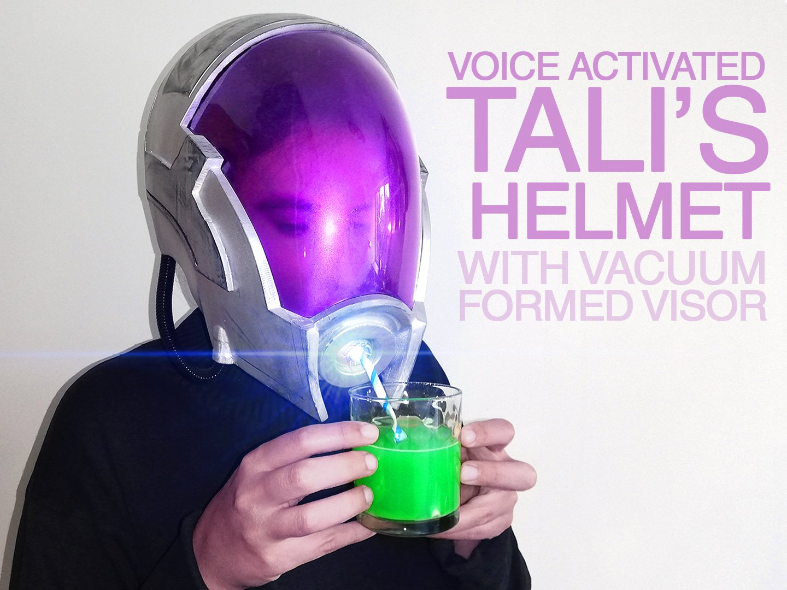
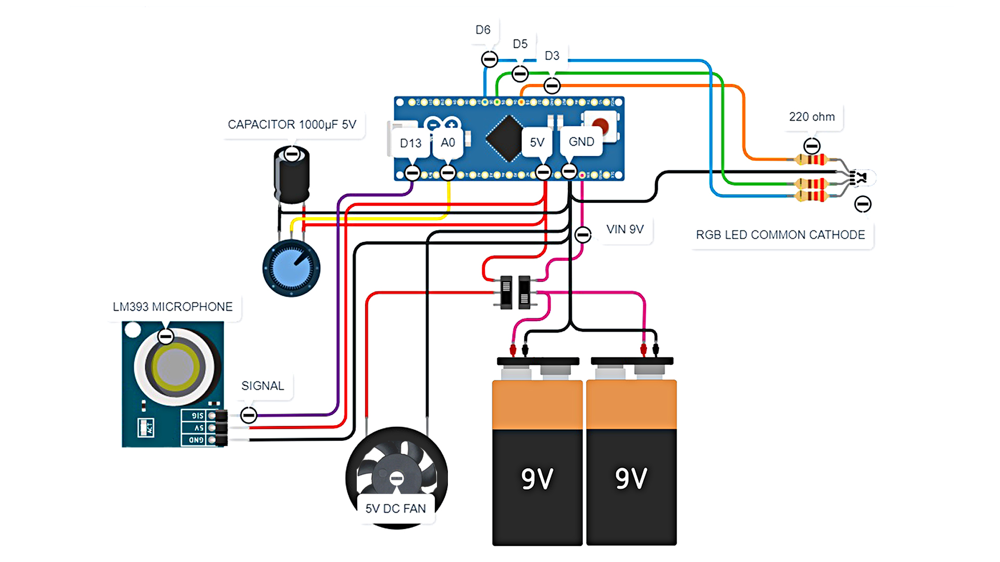

# Voice-activated, 3D-printed Tali's helmet

It blinks when you speak!

This is the code and the electronics diagram for my Tali's helmet from Mass Effect. The helmet is 3D printed and the visor is vacuum formed. I've been dreaming about making Tali's helmet for years. Finally I decided I'm proficient enough to pull it off!

Check out the full adventure (and the assembly tutorial) on YouTube:

- [Part 1](https://youtu.be/fi-FgQYNNqM)
- [Part 2](https://youtu.be/B22pOmOu8SI)

## Repository contents

| Path | Contents |
|---|---|
| [`tali_helmet/tali_helmet.ino`](tali_helmet/tali_helmet.ino) | Arduino code for the voice-activated light |
| [`images/wiring_diagram.jpg`](images/wiring_diagram.jpg) | Wiring diagram |

The 3D printing and vacuum forming files are available on [Thingiverse](https://www.thingiverse.com/thing:4983479).

## Parts

- Arduino Nano
- LM393 digital sound sensor
- RGB LED, common cathode
- 3× 220 Ω resistor
- Rotary potentiometer (brightness)
- 1000 µF capacitor
- 5 V axial fan
- 2× toggle switch
- 2× 9 V battery
- 2× 9 V battery holder
- Jumper wires

Tools: hot glue gun, soldering iron.

## Wiring

| Arduino pin | Connected to |
|---|---|
| A0 | Potentiometer (brightness) |
| D13 | Sound sensor (digital output) |
| D3 | LED red |
| D5 | LED green |
| D6 | LED blue |

## How it works

The potentiometer sets the brightness of the light. When the sound sensor detects your voice, the light fades out, and when you stop speaking it fades back in to the set brightness. Below a minimum brightness the light is switched off, to prevent unbalanced RGB color flickering.

## 3D model

The model was based on two sources:

- [Tali Mass Effect Helmet](https://www.thingiverse.com/thing:3380207) by Rainyfire, licensed under CC BY 4.0
- The in-game Tali model extracted from Mass Effect 3

The files were designed and split for 3D printing (for a 180×180 mm build plate). There's also a 3D-printable buck for vacuum forming of the visor and some small extras. The model was scaled for a generic female head (56–60 cm head circumference).

## Links

- [Arduino Project Hub](https://projecthub.arduino.cc/bzqp/voice-activated-3d-printed-talis-helmet-18ea52)
- [Thingiverse](https://www.thingiverse.com/thing:4983479)

## License

Originally published on 6 October 2021.

Tali's helmet by bzqp is licensed under the [Creative Commons Attribution-NonCommercial 4.0 International](https://creativecommons.org/licenses/by-nc/4.0/) license (CC BY-NC 4.0). See [LICENSE](LICENSE).

Mass Effect and Tali'Zorah are trademarks of Electronic Arts Inc. This is a fan project and is not affiliated with or endorsed by Electronic Arts or BioWare.
